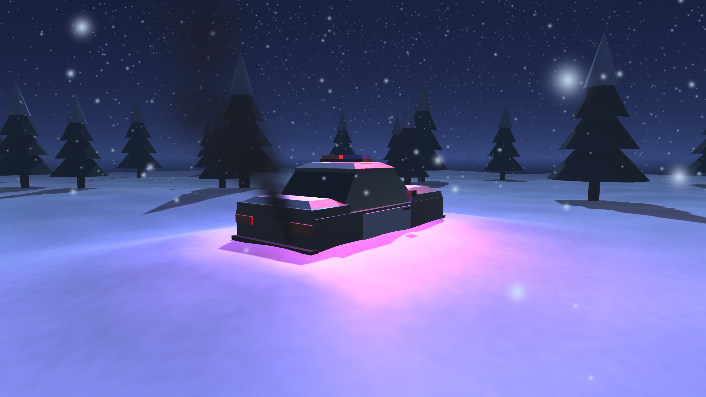

# Unity-Taller-Invierno

Taller 2 de Desarrollo de Videojuegos: escena invernal con una patrulla de policía enterrada en la nieve, sirenas giratorias controladas por script y tormenta de nieve.

## Cómo abrirlo

1. Unity **6000.6.5f1** (Built-in Render Pipeline).
2. Unity Hub → Add → seleccionar esta carpeta.
3. Abrir `Assets/Scenes/WinterScene.unity` y pulsar Play.

## Jerarquía de la escena

| # | Objeto | Componente | Detalle |
|---|---|---|---|
| 1 | Main Camera | Cámara | Encuadre diagonal hacia el coche |
| 2 | Moon_Light | Directional Light | Azul pálido, intensidad baja, sombras suaves |
| 3 | Snow_Terrain | Malla | Suelo con relieve y textura de nieve; incluye los pinos del fondo |
| 4 | Police_Car | Empty | Y = -0.5, semienterrado |
| 5 | ↳ Car_Mesh | Malla | Carrocería de la patrulla |
| 6 | ↳ Siren_Pivot | Empty + `SirenRotation` | Sobre el techo |
| 7 | ↳↳ Red_Light | Point Light | Roja, lado izquierdo del pivote |
| 8 | ↳↳ Blue_Light | Point Light | Azul, lado opuesto |
| 9 | ↳ Exhaust_Smoke | Particle System | Cono estrecho, gris oscuro a transparente, tamaño creciente |
| 10 | Global_Blizzard | Particle System | Caja sobre la escena, nieve cayendo con gravedad moderada |

## Script

`Assets/Scripts/SirenRotation.cs` está asignado solo a `Siren_Pivot`. Expone `rotationSpeed` en el Inspector y rota con `Transform.Rotate()` en `Update()` multiplicando por `Time.deltaTime`.
